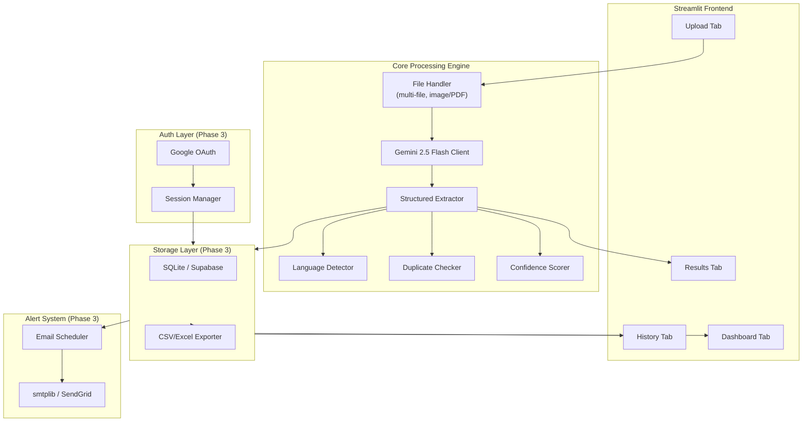
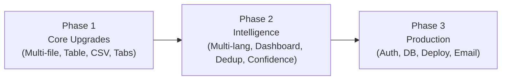
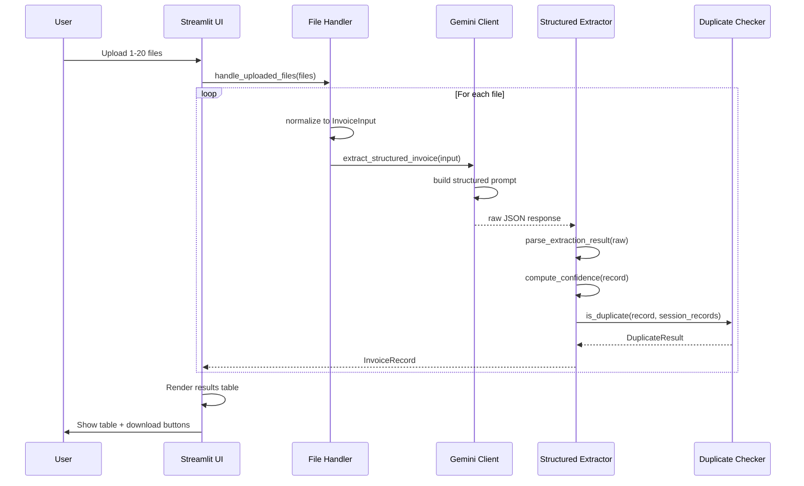
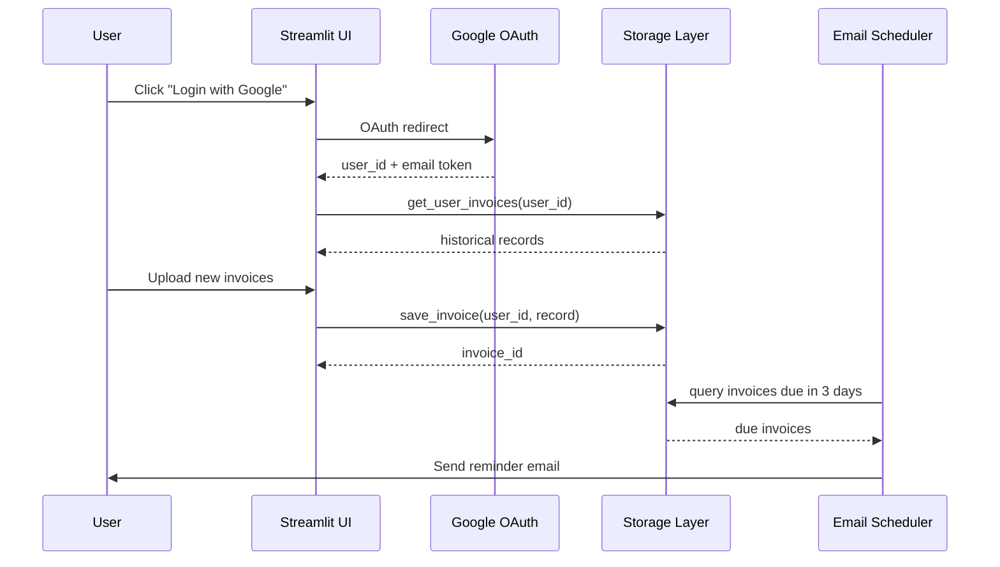

# Design Document: BillBrain AI

> "Your smart finance assistant that reads, understands, and organizes your bills instantly."

## Overview

BillBrain AI is a comprehensive upgrade of the existing Invoice Extractor project. It transforms a single-file Q&A tool into a full-featured, multi-phase AI finance assistant capable of batch invoice processing, structured data extraction, smart dashboards, duplicate detection, multi-language support, user authentication, persistent storage, and email alerting. The system is built on Streamlit with Gemini 2.5 Flash as the AI backbone and progressively adds capabilities across three phases.

The upgrade is designed to be backward-compatible with the existing codebase — the core Gemini integration and file-handling utilities are preserved and extended rather than replaced. Each phase is independently deployable, allowing incremental rollout without breaking existing functionality.

---

## Architecture

### High-Level System Architecture



### Phase Rollout Architecture



---

## Components and Interfaces

### Component 1: File Handler

**Purpose**: Accept 1–20 files (images or PDFs), normalize each into a processable unit for Gemini.

**Interface**:
```python
def handle_uploaded_files(files: list[UploadedFile]) -> list[InvoiceInput]:
    """
    Accepts a list of Streamlit UploadedFile objects.
    Returns a list of InvoiceInput objects ready for extraction.
    Raises: FileLimitExceededError if len(files) > 20
    """

def input_image_setup(file: UploadedFile) -> dict:
    """Returns Gemini-compatible image part dict."""

def extract_pdf_text(file: UploadedFile) -> str:
    """Extracts raw text from PDF using PyPDF2."""
```

**Responsibilities**:
- Validate file count (max 20) and types (jpg, jpeg, png, pdf)
- Convert images to Gemini inline_data format
- Extract text from PDFs
- Return a normalized `InvoiceInput` per file

---

### Component 2: Gemini Client

**Purpose**: Wraps the Gemini 2.5 Flash API with structured extraction prompts.

**Interface**:
```python
def get_gemini_response(
    system_prompt: str,
    file_input: dict | str,
    user_prompt: str
) -> str:
    """Calls Gemini 2.5 Flash and returns raw text response."""

def extract_structured_invoice(invoice_input: InvoiceInput) -> RawExtractionResult:
    """
    Sends a structured extraction prompt to Gemini.
    Returns raw JSON string with invoice fields.
    """
```

**Responsibilities**:
- Manage API key configuration via `st.secrets`
- Construct structured extraction prompts
- Handle API errors and retries (max 3)
- Return raw text for downstream parsing

---

### Component 3: Structured Extractor

**Purpose**: Parse Gemini's raw output into a typed `InvoiceRecord` and compute confidence scores.

**Interface**:
```python
def parse_extraction_result(raw: str) -> InvoiceRecord:
    """Parses Gemini JSON output into InvoiceRecord."""

def compute_confidence(record: InvoiceRecord) -> ConfidenceReport:
    """
    Returns High/Medium/Low confidence per field
    based on field presence and format validity.
    """
```

**Responsibilities**:
- JSON parsing with fallback for malformed responses
- Field validation (date format, amount as float, etc.)
- Confidence scoring per field
- Language detection passthrough

---

### Component 4: Duplicate Checker

**Purpose**: Detect duplicate invoices within a session or across stored history.

**Interface**:
```python
def is_duplicate(
    record: InvoiceRecord,
    existing: list[InvoiceRecord]
) -> DuplicateResult:
    """
    Returns DuplicateResult with is_duplicate flag
    and matching record reference if found.
    Matching criteria: vendor + amount + date.
    """
```

**Responsibilities**:
- Normalize vendor names (lowercase, strip whitespace) before comparison
- Compare amount as float with ±0.01 tolerance
- Compare date as `datetime.date` object
- Return match details for UI warning display

---

### Component 5: Dashboard Engine

**Purpose**: Aggregate extracted invoice records into summary statistics.

**Interface**:
```python
def compute_dashboard(records: list[InvoiceRecord]) -> DashboardSummary:
    """
    Computes:
    - Total spent this month
    - Top vendor by total spend
    - Overdue invoices (due_date < today)
    - Invoice count by month
    """
```

**Responsibilities**:
- Filter records by current calendar month
- Aggregate amounts per vendor
- Flag overdue invoices (due_date < `datetime.date.today()`)
- Return structured summary for Streamlit metrics display

---

### Component 6: Export Engine

**Purpose**: Convert a list of `InvoiceRecord` objects to CSV or Excel.

**Interface**:
```python
def export_to_csv(records: list[InvoiceRecord]) -> bytes:
    """Returns UTF-8 encoded CSV bytes for st.download_button."""

def export_to_excel(records: list[InvoiceRecord]) -> bytes:
    """Returns Excel bytes (openpyxl) for st.download_button."""
```

**Responsibilities**:
- Map `InvoiceRecord` fields to column headers
- Handle None values gracefully (empty string in output)
- Return bytes for Streamlit's download button

---

### Component 7: Storage Layer (Phase 3)

**Purpose**: Persist invoice records per authenticated user.

**Interface**:
```python
def save_invoice(user_id: str, record: InvoiceRecord) -> str:
    """Saves record to DB, returns generated invoice_id."""

def get_user_invoices(user_id: str) -> list[InvoiceRecord]:
    """Returns all invoices for a given user."""

def delete_invoice(invoice_id: str) -> bool:
    """Soft-deletes an invoice record."""
```

**Responsibilities**:
- Abstract over SQLite (local) and Supabase (cloud)
- Enforce user-scoped data isolation
- Handle schema migrations via simple version table

---

### Component 8: Email Alert System (Phase 3)

**Purpose**: Send due-date reminder emails 3 days before invoice due dates.

**Interface**:
```python
def check_and_send_reminders(user_id: str, user_email: str) -> list[str]:
    """
    Queries invoices due within 3 days.
    Sends reminder email for each.
    Returns list of invoice_ids that triggered alerts.
    """
```

**Responsibilities**:
- Query storage for invoices where `due_date - today <= 3 days`
- Compose reminder email with vendor, amount, due date
- Send via smtplib (local) or SendGrid (production)
- Track sent alerts to avoid duplicate emails

---

## Data Models

### InvoiceInput

```python
@dataclass
class InvoiceInput:
    filename: str
    file_type: str          # "image" | "pdf"
    content: dict | str     # Gemini image part dict OR extracted PDF text
    detected_language: str  # "en" | "hi" | "ta" | "mr" | auto-detected
```

### InvoiceRecord

```python
@dataclass
class InvoiceRecord:
    invoice_id: str         # UUID, generated on creation
    user_id: str | None     # None for unauthenticated sessions
    filename: str
    vendor: str | None
    invoice_date: date | None
    items: list[str]        # Line item descriptions
    total_amount: float | None
    tax_amount: float | None
    due_date: date | None
    currency: str           # Default "INR"
    detected_language: str
    confidence: ConfidenceReport
    extracted_at: datetime
    is_duplicate: bool
    duplicate_of: str | None  # invoice_id of matching record
```

### ConfidenceReport

```python
@dataclass
class ConfidenceReport:
    vendor: str             # "High" | "Medium" | "Low"
    invoice_date: str
    total_amount: str
    tax_amount: str
    due_date: str
    items: str
    overall: str            # Lowest confidence across all fields
```

**Confidence Rules**:
- High: Field present, passes format validation
- Medium: Field present but format uncertain (e.g., ambiguous date)
- Low: Field missing or extraction failed

### DashboardSummary

```python
@dataclass
class DashboardSummary:
    total_spent_this_month: float
    top_vendor: str | None
    top_vendor_amount: float
    overdue_invoices: list[InvoiceRecord]
    invoice_count_by_month: dict[str, int]  # "YYYY-MM" -> count
```

### DuplicateResult

```python
@dataclass
class DuplicateResult:
    is_duplicate: bool
    matching_invoice_id: str | None
    matching_filename: str | None
```

---

## Sequence Diagrams

### Phase 1: Multi-File Batch Extraction Flow



### Phase 3: Authenticated User Flow



---

## Algorithmic Pseudocode

### Main Batch Processing Algorithm

```pascal
ALGORITHM process_batch(uploaded_files, session_records)
INPUT: uploaded_files: list of UploadedFile (1..20)
       session_records: list of InvoiceRecord (existing in session)
OUTPUT: results: list of InvoiceRecord

PRECONDITIONS:
  - len(uploaded_files) >= 1
  - len(uploaded_files) <= 20
  - All files are of type jpg, jpeg, png, or pdf

POSTCONDITIONS:
  - len(results) == len(uploaded_files)
  - Each result has a unique invoice_id
  - Duplicate records have is_duplicate = true

BEGIN
  results ← []

  IF len(uploaded_files) > 20 THEN
    RAISE FileLimitExceededError("Maximum 20 files allowed")
  END IF

  FOR each file IN uploaded_files DO
    // Normalize file to InvoiceInput
    invoice_input ← normalize_file(file)

    // Extract via Gemini with retry
    attempt ← 0
    raw_result ← null

    WHILE attempt < 3 AND raw_result IS null DO
      TRY
        raw_result ← get_gemini_response(EXTRACTION_PROMPT, invoice_input)
      CATCH ApiError
        attempt ← attempt + 1
        WAIT 2^attempt seconds
      END TRY
    END WHILE

    IF raw_result IS null THEN
      record ← create_failed_record(file.filename)
    ELSE
      record ← parse_extraction_result(raw_result)
      record.confidence ← compute_confidence(record)
      dup_result ← is_duplicate(record, session_records + results)
      record.is_duplicate ← dup_result.is_duplicate
      record.duplicate_of ← dup_result.matching_invoice_id
    END IF

    results.append(record)
  END FOR

  RETURN results
END
```

**Loop Invariant**: At the start of each iteration, `results` contains only valid `InvoiceRecord` objects for all previously processed files.

---

### Confidence Scoring Algorithm

```pascal
ALGORITHM compute_confidence(record)
INPUT: record: InvoiceRecord
OUTPUT: report: ConfidenceReport

BEGIN
  scores ← {}

  FOR each field IN [vendor, invoice_date, total_amount, tax_amount, due_date, items] DO
    value ← record[field]

    IF value IS null OR value IS empty THEN
      scores[field] ← "Low"
    ELSE IF NOT passes_format_validation(field, value) THEN
      scores[field] ← "Medium"
    ELSE
      scores[field] ← "High"
    END IF
  END FOR

  // Overall = lowest confidence across all fields
  IF "Low" IN scores.values() THEN
    overall ← "Low"
  ELSE IF "Medium" IN scores.values() THEN
    overall ← "Medium"
  ELSE
    overall ← "High"
  END IF

  RETURN ConfidenceReport(scores, overall)
END
```

**Postcondition**: `overall` is always the minimum confidence level across all individual field scores.

---

### Duplicate Detection Algorithm

```pascal
ALGORITHM is_duplicate(candidate, existing_records)
INPUT: candidate: InvoiceRecord
       existing_records: list of InvoiceRecord
OUTPUT: DuplicateResult

PRECONDITIONS:
  - candidate.vendor is normalized (lowercase, stripped)
  - candidate.total_amount is float or null
  - candidate.invoice_date is date or null

BEGIN
  candidate_vendor ← normalize_string(candidate.vendor)
  candidate_amount ← candidate.total_amount
  candidate_date ← candidate.invoice_date

  FOR each record IN existing_records DO
    vendor_match ← normalize_string(record.vendor) == candidate_vendor
    amount_match ← abs(record.total_amount - candidate_amount) <= 0.01
    date_match ← record.invoice_date == candidate_date

    IF vendor_match AND amount_match AND date_match THEN
      RETURN DuplicateResult(
        is_duplicate = true,
        matching_invoice_id = record.invoice_id,
        matching_filename = record.filename
      )
    END IF
  END FOR

  RETURN DuplicateResult(is_duplicate = false)
END
```

**Loop Invariant**: All records checked so far have not matched the candidate on all three criteria simultaneously.

---

### Multi-Language Extraction Prompt Construction

```pascal
ALGORITHM build_extraction_prompt(invoice_input)
INPUT: invoice_input: InvoiceInput
OUTPUT: prompt: str

BEGIN
  base_prompt ← """
    You are an expert invoice data extractor.
    The invoice may be in English, Hindi, Tamil, Marathi, or another language.
    First detect the language, then extract the following fields as JSON:
    {
      "vendor": string or null,
      "invoice_date": "YYYY-MM-DD" or null,
      "items": [list of item descriptions],
      "total_amount": float or null,
      "tax_amount": float or null,
      "due_date": "YYYY-MM-DD" or null,
      "currency": string (default "INR"),
      "detected_language": ISO 639-1 code
    }
    Return ONLY valid JSON. No explanation.
  """

  RETURN base_prompt
END
```

---

## Key Functions with Formal Specifications

### `handle_uploaded_files(files)`

**Preconditions**:
- `files` is a non-empty list
- `len(files) <= 20`
- Each file has `.type` in `["image/jpeg", "image/png", "application/pdf"]`

**Postconditions**:
- Returns list of `InvoiceInput` with `len(result) == len(files)`
- Each `InvoiceInput.content` is either a Gemini image dict or a non-empty string
- No file is silently dropped; failed files produce an `InvoiceInput` with `file_type = "error"`

**Loop Invariant**: All previously processed files have a corresponding `InvoiceInput` in the output list.

---

### `parse_extraction_result(raw)`

**Preconditions**:
- `raw` is a non-empty string
- `raw` is expected to be valid JSON (but may not be)

**Postconditions**:
- Returns a valid `InvoiceRecord` in all cases (never raises)
- If JSON parsing fails, all fields are `None` and `confidence.overall = "Low"`
- `invoice_id` is always a fresh UUID

---

### `compute_dashboard(records)`

**Preconditions**:
- `records` is a list (may be empty)
- Each record's `total_amount` is `float | None`
- Each record's `due_date` is `date | None`

**Postconditions**:
- `total_spent_this_month` is the sum of `total_amount` for records where `invoice_date` is in the current calendar month; `0.0` if none
- `overdue_invoices` contains only records where `due_date < datetime.date.today()`
- `top_vendor` is `None` if `records` is empty

---

## Error Handling

### Scenario 1: Gemini API Failure

**Condition**: API call raises an exception (network error, quota exceeded, invalid key)
**Response**: Retry up to 3 times with exponential backoff (2s, 4s, 8s). After 3 failures, mark the invoice record as failed with all fields `None` and `confidence.overall = "Low"`.
**Recovery**: Display a warning banner in the UI: "⚠️ Could not extract [filename] — API error. Please retry."

### Scenario 2: Malformed Gemini JSON Response

**Condition**: Gemini returns text that is not valid JSON
**Response**: Attempt regex-based field extraction as fallback. If fallback also fails, return empty record.
**Recovery**: Set `confidence.overall = "Low"` and display field-level "Extraction failed" in the results table.

### Scenario 3: File Limit Exceeded

**Condition**: User uploads more than 20 files
**Response**: Reject the upload immediately before any processing begins.
**Recovery**: Show error: "❌ Maximum 20 files allowed per batch. Please reduce your selection."

### Scenario 4: Unsupported File Type

**Condition**: User uploads a file with an unsupported MIME type
**Response**: Skip the file and log a warning.
**Recovery**: Show per-file warning: "⚠️ [filename] is not a supported format (jpg, png, pdf)."

### Scenario 5: Duplicate Invoice Detected

**Condition**: `is_duplicate` returns `True` for a processed record
**Response**: Mark the record with `is_duplicate = True` and surface a warning in the UI.
**Recovery**: Highlight the row in yellow with a tooltip: "⚠️ Possible duplicate of [original filename]."

### Scenario 6: Authentication Failure (Phase 3)

**Condition**: Google OAuth token is invalid or expired
**Response**: Clear session state and redirect to login page.
**Recovery**: Show: "🔒 Session expired. Please log in again."

### Scenario 7: Email Send Failure (Phase 3)

**Condition**: SMTP or SendGrid call fails
**Response**: Log the failure with invoice_id and retry once after 60 seconds.
**Recovery**: If retry fails, log to DB as `alert_status = "failed"` for manual review.

---

## Testing Strategy

### Unit Testing Approach

Test each component in isolation using `pytest`. Key test cases:

- `test_handle_uploaded_files_limit`: Assert `FileLimitExceededError` raised for 21+ files
- `test_parse_extraction_result_valid_json`: Assert all fields populated correctly
- `test_parse_extraction_result_malformed_json`: Assert graceful fallback, no exception raised
- `test_compute_confidence_all_fields_present`: Assert `overall = "High"`
- `test_compute_confidence_missing_fields`: Assert `overall = "Low"`
- `test_is_duplicate_exact_match`: Assert `is_duplicate = True` for same vendor/amount/date
- `test_is_duplicate_amount_tolerance`: Assert match within ±0.01 float tolerance
- `test_compute_dashboard_overdue`: Assert overdue invoices correctly identified
- `test_export_to_csv_empty`: Assert valid empty CSV returned, no exception

### Property-Based Testing Approach

**Property Test Library**: `hypothesis`

Key properties to verify:

- **Confidence monotonicity**: For any `InvoiceRecord`, adding more non-null fields never decreases `overall` confidence
- **Duplicate symmetry**: If record A is a duplicate of record B, then B is a duplicate of A (same vendor/amount/date)
- **Export roundtrip**: For any list of `InvoiceRecord`, exporting to CSV and re-parsing produces equivalent records
- **Dashboard total correctness**: `total_spent_this_month` always equals the sum of `total_amount` for current-month records
- **Batch size invariant**: `len(process_batch(files)) == len(files)` for all valid input sizes 1–20

### Integration Testing Approach

- **Gemini integration test**: Upload a known sample invoice (English + Hindi) and assert expected fields are extracted with `confidence.overall != "Low"`
- **End-to-end tab flow**: Simulate upload → extraction → results table → CSV download using Streamlit's `AppTest` framework
- **Auth + storage flow (Phase 3)**: Mock Google OAuth, save invoice, retrieve from DB, assert data integrity

---

## Performance Considerations

- **Batch processing**: Files are processed sequentially (not in parallel) to avoid Gemini rate limits. For 20 files, expected processing time is ~40–60 seconds at ~2–3s per file.
- **PDF text extraction**: PyPDF2 is synchronous and fast for text-based PDFs. Scanned PDFs (image-only) will be handled by passing the PDF as an image to Gemini instead.
- **Session state caching**: Extracted records are stored in `st.session_state` to avoid re-processing on tab switches.
- **Dashboard computation**: Computed on-demand from session/DB records; no background jobs needed for Phase 1–2.
- **Export**: CSV/Excel generation is in-memory using `pandas` and `openpyxl`; no temp files written to disk.

---

## Security Considerations

- **API Key**: Stored in `st.secrets` (never in code or `.env` committed to git). For Phase 3 cloud deployment, use Streamlit Cloud secrets manager.
- **OAuth tokens**: Google OAuth tokens stored only in `st.session_state`, never persisted to DB. Session cleared on logout.
- **User data isolation**: All DB queries are scoped by `user_id`. No cross-user data access is possible via the storage interface.
- **File validation**: MIME type and file size (max 10MB per file) validated before any processing.
- **Email**: SMTP credentials stored in `st.secrets`. SendGrid API key never logged.
- **SQL injection**: All DB queries use parameterized statements (SQLite `?` placeholders or Supabase client SDK).

---

## Dependencies

### Phase 1 (Core)

| Package | Purpose |
|---|---|
| `streamlit >= 1.35` | UI framework with tabs support |
| `google-generativeai >= 0.8` | Gemini 2.5 Flash API |
| `PyPDF2` | PDF text extraction |
| `Pillow` | Image handling |
| `pandas` | DataFrame for results table + CSV export |
| `openpyxl` | Excel export |
| `python-dotenv` | Local `.env` loading |

### Phase 2 (Intelligence)

| Package | Purpose |
|---|---|
| `langdetect` | Fallback language detection |

### Phase 3 (Production)

| Package | Purpose |
|---|---|
| `streamlit-google-auth` or `authlib` | Google OAuth integration |
| `supabase-py` | Supabase client (if using Supabase) |
| `sendgrid` | Email alerts (production) |
| `apscheduler` | Due-date reminder scheduling |

---

## UI Layout

### Tab Structure

```
┌─────────────────────────────────────────────────────────┐
│  🧠 BillBrain AI                          [Login] button │
├──────────┬──────────┬──────────┬──────────────────────── │
│ 📤 Upload│ 📊 Results│ 🕐 History│ 📈 Dashboard           │
├──────────┴──────────┴──────────┴──────────────────────── │
│                                                          │
│  [Upload Tab]                                            │
│  ┌──────────────────────────────────────────────────┐   │
│  │  Drag & drop up to 20 invoices (jpg/png/pdf)     │   │
│  └──────────────────────────────────────────────────┘   │
│  [🔎 Extract All Invoices]                               │
│                                                          │
│  [Results Tab]                                           │
│  Vendor | Date | Items | Amount | Tax | Due | Confidence │
│  ──────────────────────────────────────────────────────  │
│  ⚠️ Duplicate warning rows highlighted in yellow         │
│  [📥 Download CSV]  [📥 Download Excel]                  │
│                                                          │
│  [Dashboard Tab]                                         │
│  Total Spent: ₹X,XXX  |  Top Vendor: ABC  |  Overdue: 2 │
│                                                          │
│  [History Tab] (Phase 3 — requires login)                │
│  All past invoices with search + filter                  │
└─────────────────────────────────────────────────────────┘
```

---

## Migration from Existing Code

The existing `app.py` functions are preserved and extended:

| Existing Function | Status | Change |
|---|---|---|
| `get_gemini_response()` | Extended | Model upgraded to `gemini-2.5-flash`; prompt updated for structured JSON output |
| `input_image_setup()` | Preserved | No changes needed |
| `extract_pdf_text()` | Preserved | No changes needed |
| Single file uploader | Replaced | `st.file_uploader(..., accept_multiple_files=True)` |
| Free-text Q&A | Replaced | Structured extraction prompt |
| Plain text output | Replaced | `st.dataframe()` table with confidence badges |


---

## Correctness Properties

*A property is a characteristic or behavior that should hold true across all valid executions of a system — essentially, a formal statement about what the system should do. Properties serve as the bridge between human-readable specifications and machine-verifiable correctness guarantees.*

### Property 1: Batch Size Invariant

*For any* valid list of 1–20 uploaded files, the File_Handler SHALL return a list of InvoiceInput objects whose length equals the number of input files — no file is silently dropped or duplicated.

**Validates: Requirements 1.6, 7.2**

---

### Property 2: File Limit Rejection

*For any* batch of more than 20 files, the File_Handler SHALL raise a FileLimitExceededError before producing any InvoiceInput objects.

**Validates: Requirements 1.2**

---

### Property 3: File Type Acceptance

*For any* uploaded file, the File_Handler SHALL accept it if and only if its MIME type is one of `image/jpeg`, `image/png`, or `application/pdf`; all other MIME types SHALL be rejected.

**Validates: Requirements 1.3**

---

### Property 4: InvoiceInput Field Completeness

*For any* file successfully processed by the File_Handler, the resulting InvoiceInput SHALL have non-null values for `filename`, `file_type`, and `content`.

**Validates: Requirements 2.3**

---

### Property 5: Error Record on Normalization Failure

*For any* file that cannot be normalized, the File_Handler SHALL produce an InvoiceInput with `file_type = "error"` rather than omitting the file from the output list.

**Validates: Requirements 1.7**

---

### Property 6: parse_extraction_result Never Raises

*For any* input string — including empty strings, random bytes, and malformed JSON — `parse_extraction_result` SHALL return a valid InvoiceRecord and SHALL never raise an exception.

**Validates: Requirements 4.4**

---

### Property 7: Failed Parse Produces Low Confidence Record

*For any* input string that cannot be parsed as JSON and for which regex fallback also fails, `parse_extraction_result` SHALL return an InvoiceRecord where all data fields are None and `confidence.overall = "Low"`.

**Validates: Requirements 4.3**

---

### Property 8: Unique Invoice IDs

*For any* two InvoiceRecords produced by separate calls to `parse_extraction_result`, their `invoice_id` values SHALL be distinct UUIDs.

**Validates: Requirements 4.5**

---

### Property 9: Confidence Overall is Minimum of Field Scores

*For any* InvoiceRecord, `ConfidenceReport.overall` SHALL equal the minimum confidence level across all individual field scores — where Low < Medium < High.

**Validates: Requirements 5.5, 5.6**

---

### Property 10: Confidence Field Assignment Rules

*For any* InvoiceRecord field: if the field is null or empty it SHALL receive `"Low"` confidence; if it is present but fails format validation it SHALL receive `"Medium"` confidence; if it is present and passes format validation it SHALL receive `"High"` confidence.

**Validates: Requirements 5.2, 5.3, 5.4**

---

### Property 11: Duplicate Detection Consistency

*For any* pair of InvoiceRecords that share the same normalized vendor name, a total_amount difference ≤ 0.01, and the same invoice_date, the Duplicate_Checker SHALL report them as duplicates; for any pair that differs on at least one of these three criteria, it SHALL not report them as duplicates.

**Validates: Requirements 6.2, 6.3**

---

### Property 12: Vendor Name Normalization Idempotence

*For any* vendor name string, applying the normalization function (lowercase + strip whitespace) twice SHALL produce the same result as applying it once.

**Validates: Requirements 6.3**

---

### Property 13: API Retry on Failure

*For any* Gemini API call that raises an exception, the Gemini_Client SHALL retry the call up to 3 times before giving up, and SHALL NOT return a result from a failed attempt.

**Validates: Requirements 3.3, 3.4**

---

### Property 14: CSV Export Round-Trip

*For any* non-empty list of InvoiceRecords, exporting to CSV and re-parsing the resulting bytes SHALL produce a list of records with equivalent field values (None fields represented as empty strings).

**Validates: Requirements 9.1, 9.3, 9.4**

---

### Property 15: Export Column Completeness

*For any* list of InvoiceRecords exported to CSV or Excel, the resulting file SHALL contain a column for every field defined in InvoiceRecord.

**Validates: Requirements 9.3**

---

### Property 16: Dashboard Total Correctness

*For any* list of InvoiceRecords, `total_spent_this_month` SHALL equal the exact sum of `total_amount` for all records whose `invoice_date` falls within the current calendar month (treating None amounts as 0.0).

**Validates: Requirements 11.1, 11.2**

---

### Property 17: Overdue Invoice Filtering

*For any* list of InvoiceRecords, `overdue_invoices` SHALL contain exactly those records where `due_date < datetime.date.today()` — no more, no fewer.

**Validates: Requirements 11.5**

---

### Property 18: Top Vendor Correctness

*For any* non-empty list of InvoiceRecords, `top_vendor` SHALL be the vendor whose summed `total_amount` across all records is greater than or equal to every other vendor's summed total.

**Validates: Requirements 11.3**
